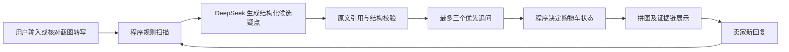

# 证据拼图 · 二手数码购前核验 V2.3

## V2.3 型号与价格对比（2026-10-26，本地候选版）

型号入口补充 Apple 官方已发布的 iPhone 17、iPhone 18 Pro/Pro Max、AirPods 5 两种充电盒版本及 AirPods Pro 第 3 代。普通版 iPhone 18 尚未查到 Apple 官方发布信息，仍可通过“其他型号（手动填写）”录入待核实名称。

价格判断新增可选的同款二手挂牌价样本：用户填 3 至 5 个同型号、配置和成色接近的报价，可看到样本中位数及标价偏离幅度；填写了来源和日期时一并留在记录中。结果以相对中位数 ±20% 为“样本内偏低/偏高”的显示界限，这是提醒查看差异的产品规则，不是市场统计结论。该比较不能代表实时全市场成交价，也不会只凭价格高低认定真假或诈骗。未填可比样本时，应用明确显示无法评估市价合理性。原有商品页、描述和聊天金额矛盾检查继续运行。

型号核对来源：[Apple 中国 iPhone 产品目录](https://www.apple.com.cn/iphone/)、[iPhone 18 Pro 与 Pro Max 发布信息](https://www.apple.com.cn/newsroom/2026/09/apple-debuts-iphone-18-pro-and-iphone-18-pro-max/)、[AirPods 5 产品页](https://www.apple.com.cn/airpods-5/)及 [AirPods Pro 3 产品页](https://www.apple.com.cn/airpods-pro/)。核对日期：2026-10-26。型号选项需随官方发布信息定期更新；“其他型号（手动填写）”始终保留。

## V2.2 集中修订（2026-10-25）

本版针对此前截图中出现的重复追问、通用警告盖过具体问题、多轮进展不清楚等情况集中修订。原文先由程序编号，模型选编号，程序取回原句；保留严格引用检查，并在格式或引用出错时最多纠正一次。已经找到的有效缺口继续展示，分析异常单独提示。引用存在仍不等于推断正确或商品真实。

页面增加“重新分析当前材料”和“下载本次核验记录”；动画按钮明确为“重播动画”。卖家具体解释、仍待核实的问题和本轮新增疑点分别显示；笼统的“放心吧”不会自动清掉旧问题。价格追问合并，显卡使用专门验货清单。支持未知型号、未标价和独立的下单付款渠道。话术文件 `skills/seller-chat/SKILL.md` 漏传时使用内置简版，但完整部署仍应保留原文件。

新增 `evidence_refs.py`、`review_record.py` 必须上传；保留 `cart_component/index.html`、`skills/seller-chat/SKILL.md`、`.streamlit/config.toml` 的目录。不能只替换 app.py。V2.2 已有线上运行和 GitHub 同步截图；本次 V2.3 修改仍是本地候选版，上传并重新部署后才会出现新型号与价格对比。离线测试不等于真实模型效果评测。旧版原始记录另行留存，部署包不含个人评测原始材料。

离线验证（不调用模型）：

```text
python -X utf8 -m unittest discover -s tests -p "test_*.py" -v
```

组件交互测试需要 Node.js，只用于开发测试，运行应用不需要 Node.js。页面流程测试需要本机回环连接。测试使用模拟模型响应，不产生真实模型费用。版本变更与上线验收见 `V2.2更新与复测说明.md`。

可在 Streamlit Community Cloud 部署的证据优先型原型。用户提供商品页面文字、价格、型号及可选聊天截图；应用找出可追溯疑点、规划追问、接收卖家回复并更新购物车状态。**它不鉴定真伪，不保证购买安全。**

## V2 的结构



`app.py` 处理表单、会话与界面；`domain_knowledge.py` 维护平台提示、品类检查清单和型号入口；`agent_core.py` 负责 LangGraph 状态图、规则、模型输出结构、引用校验及购物车门控；`evidence_refs.py` 提供原文编号与查找；`review_record.py` 生成可导出记录；`image_dialogue.py` 负责截图转写；`evaluate.py` 提供同模型逐轮对照记录。`cart_scene.py`、`product_preview.py` 与 `puzzle_feedback.py` 负责互动呈现。

默认每轮进行 **1 次文本模型调用**，只有结构或引用检查失败时才尝试第 2 次，两类纠正共用两次上限。文本分析和图片转写均设 35 秒单次请求超时，不另加客户端自动重试；这不是整页总响应时间保证。追问最多 3 个，模型候选疑点最多 8 个。过长材料会导致保守判断；多轮保留最近三条卖家回复和上轮未核实疑点。调用耗时、token 用量和处理轨迹随记录导出，供开发和评测使用，不等于已经证实更快或更准确。

## 相比旧版的关键变化

| 旧版 | V2 |
| --- | --- |
| 一个长提示词生成 Markdown，购物车通过寻找固定短语决定状态 | 模型给出 JSON 候选疑点；程序检查原文引用后独立决定状态 |
| 规则只检查部分价格、型号和缺失字段 | 增加站外付款线索、材料中诱导模型的指令检测和长文本截取保护 |
| 模型写了“有风险”就难以判断证据在哪里 | 每条疑点保留来源、原文片段、优先级、追问和处理状态 |
| 新一轮只读上一轮长篇分析 | 新一轮携带未核实疑点，减少历史文本膨胀并防止疑点无故消失 |
| 输出难以回归测试 | 增加离线情景测试与可扩展的同模型对照脚本 |

引用校验只证明**该文字确实出现在提交材料里**，不能证明卖家说的是真的，也不能证明模型对原文的解释正确。高价值数码交易仍需凭证、实物和平台订单核对。

## 本地运行

1. 安装依赖：`python -m pip install -r requirements.txt`。
2. 将 `.env.example` 复制为 `.env`，只在本地 `.env` 中填写 DeepSeek Key。
3. 运行：`streamlit run app.py`。

截图识别可选择最多 3 张 PNG、JPG 或 WebP 图片。上传前遮盖个人信息；模型转写后，使用者先核对可编辑文字，再提交分析。新回复可继续输入下一轮。刷新浏览器或服务重启可能清除会话状态。

## 部署更新

按 `DEPLOY.md` 把部署包内容更新至应用正在使用的仓库和分支，保留子目录结构。**不要上传 `.env`、个人聊天原图、实际核验导出记录或 API Key。** 本包不修改现有 Cloud Secrets。

## 效果评价

`sample_cases.jsonl` 只有 6 条明确标记为“模拟”的格式样例，不能作为性能结论。先检查格式：

```powershell
python tests/test_agent_v2.py
python evaluate.py --input sample_cases.jsonl --validate-only
```

补齐经过授权且去标识的案例、人工预期疑点后，才运行同模型对照；下面的命令会产生 API 调用费用：

```powershell
python evaluate.py --input sample_cases.jsonl --output comparison.csv
```

输出记录版本、模型、时间、双方完整输入输出、耗时、用量、调用错误和引用检查情况；每对结果完成即保存，拒绝覆盖旧文件。关键词覆盖只是粗筛，不能称为准确率。普通问答和 Agent 得到相同外部材料，各自保留自己的历史回答，互不借用结果。两次纠正上限带来的调用成本也应纳入比较。

`evaluation_followup_cases_draft.jsonl` 是新增的三条多轮模拟草稿，共九轮，预期须先由人工复核；运行前先使用 `--validate-only` 检查格式。不是实测结果。按预先固定的人工标准评价遗漏、误报、引用是否支持结论、追问可执行性及跨轮更新，保留失败记录。比赛资料没有规定必须测 30 条；要报告“新版在 30 条上的效果”，才需要新版实际跑完对应 30 条并复核，不能混用旧版输出。

## 参考的开源设计

- [mrdavidlong/ecommerce-ai-assistant](https://github.com/mrdavidlong/ecommerce-ai-assistant)：借鉴购物任务在 LangGraph 中显式路由的思路。
- [yuyue1413/ecommerce-agent](https://github.com/yuyue1413/ecommerce-agent)：借鉴把商品事实绑定到可解释证据与过程轨迹的方向。
- [langchain-ai/open_deep_research](https://github.com/langchain-ai/open_deep_research)：借鉴分阶段的结构化输出和独立评价；本项目没有复制其多智能体研究流程。
- [langchain-ai/agentevals](https://github.com/langchain-ai/agentevals)：借鉴将智能体中间过程纳入评价，而非只评价最后一句话。

本项目仅参考公开架构思路，代码围绕二手数码核验任务重新实现。没有增加实时价格库、平台登录、自动付款或真伪鉴定等尚无可靠数据支持的能力。
