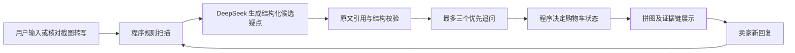

# 二手数码交易核验智能体 V2

## V2.1 评测后更新（2026-10-21，本地候选版）

30 条人工截图评测的统一改动、输入偏差和验证限制见 `评测总结与改进落实.md`。现在先进入场景，投掷后再分析；普通信息不足显示等待，拼图按结构化疑点展示来源与状态。支持未知型号、空描述以及独立的下单付款渠道。卖家追问规则位于 `skills/seller-chat/SKILL.md`，已被分析器实际读取。

部署必须同时包含 `review_policy.py`、`cart_component/index.html`、`skills/seller-chat/SKILL.md`；不能只替换 app.py。当前改动尚未上线，离线测试不等于新版 30 条真实模型复测完成。

离线验证（不调用模型）：

```text
python -X utf8 tests/test_agent_v2.py
python -X utf8 -m unittest discover -s tests -p test_batch_review.py -v
python -X utf8 -m unittest discover -s tests -p test_app_flow.py -v
python -X utf8 tests/test_scene_protocol.py
```

最后一项需要 Node.js，只用于开发测试，运行应用不需要 Node.js。页面流程测试需要本机回环连接。检查结果与限制见总结文档。

可在 Streamlit Community Cloud 部署的证据优先型原型。用户提供商品页面文字、价格、型号及可选聊天截图；应用找出可追溯疑点、规划追问、接收卖家回复并更新购物车状态。**它不鉴定真伪，不保证购买安全。**

## V2 的结构



`app.py` 只处理表单、动画与界面；`domain_knowledge.py` 维护平台提示、品类检查清单和型号入口；`agent_core.py` 负责 LangGraph 状态图、规则、模型输出结构、引用校验及购物车门控；`image_dialogue.py` 负责截图转写；`evaluate.py` 提供同模型对照记录。`cart_scene.py`、`product_preview.py` 与 `puzzle_feedback.py` 保留原有互动界面。

V2 默认每轮进行 **1 次文本模型调用**，只有返回不可解析的结构时才尝试第 2 次。模型调用设置超时；追问限定最多 3 个，模型候选疑点限定最多 8 个。超过长度上限的材料会导致保守的“等待补充”判断，而不是静默放行。面向买家的页面只展示结论、可核对的依据和自然口吻的卖家追问；调用耗时、token 用量和处理轨迹保留在内部结果中，供开发和评测使用。以上是设计约束，并不等于已经证实真实环境更快或更准确。

## 相比旧版的关键变化

| 旧版 | V2 |
| --- | --- |
| 一个长提示词生成 Markdown，购物车通过寻找固定短语决定状态 | 模型给出 JSON 候选疑点；程序检查原文引用后独立决定状态 |
| 规则只检查部分价格、型号和缺失字段 | 增加站外付款线索、材料中诱导模型的指令检测和长文本截取保护 |
| 模型写了“有风险”就难以判断证据在哪里 | 每条疑点保留来源、原文片段、优先级、追问和处理状态 |
| 新一轮只读上一轮长篇分析 | 新一轮携带未核实疑点，减少历史文本膨胀并防止疑点无故消失 |
| 输出难以回归测试 | 增加离线情景测试与可扩展的同模型对照脚本 |

引用校验只证明**该文字确实出现在提交材料里**，不能证明卖家说的是真的，也不能证明模型对原文的解释正确。高价值数码交易仍需凭证、实物和平台订单核对。

## 本地运行

1. 安装依赖：`python -m pip install -r requirements.txt`。
2. 将 `.env.example` 复制为 `.env`，只在本地 `.env` 中填写 DeepSeek Key。
3. 运行：`streamlit run app.py`。

截图识别可选择最多 3 张 PNG、JPG 或 WebP 图片。上传前遮盖个人信息；模型转写后，使用者先核对可编辑文字，再提交分析。新回复可继续输入下一轮。刷新浏览器或服务重启可能清除会话状态。

## 部署更新

把部署包解压后的文件上传到原 GitHub 仓库根目录，并保留 `.streamlit/config.toml` 的目录结构。需要新增 `agent_core.py`、`domain_knowledge.py`；需要替换 `app.py`。`evaluate.py` 与 `sample_cases.jsonl` 用于比赛测试，建议一起上传。**不要上传 `.env`、个人聊天原图、真实案例原文或 API Key。** 提交后在 Streamlit Cloud 中重启应用，并用匿名样例验证。

## 效果评价

`sample_cases.jsonl` 只有 6 条明确标记为“模拟”的格式样例，不能作为性能结论。先检查格式：

```powershell
python tests/test_agent_v2.py
python evaluate.py --input sample_cases.jsonl --validate-only
```

补齐经过授权且去标识的案例、人工预期疑点后，才运行同模型对照；下面的命令会产生 API 调用费用：

```powershell
python evaluate.py --input sample_cases.jsonl --output comparison.csv
```

输出记录两种方法的关键词覆盖、耗时、引用校验数量和原文。关键词覆盖只是粗筛，仍应人工复核疑点是否真实存在、追问是否可执行、回答是否过度确定。正式报告建议至少约 30 条分层案例，并分别标注模拟与真实来源。不要把离线单元测试当成真实模型准确率。

## 参考的开源设计

- [mrdavidlong/ecommerce-ai-assistant](https://github.com/mrdavidlong/ecommerce-ai-assistant)：借鉴购物任务在 LangGraph 中显式路由的思路。
- [yuyue1413/ecommerce-agent](https://github.com/yuyue1413/ecommerce-agent)：借鉴把商品事实绑定到可解释证据与过程轨迹的方向。
- [langchain-ai/open_deep_research](https://github.com/langchain-ai/open_deep_research)：借鉴分阶段的结构化输出和独立评价；本项目没有复制其多智能体研究流程。
- [langchain-ai/agentevals](https://github.com/langchain-ai/agentevals)：借鉴将智能体中间过程纳入评价，而非只评价最后一句话。

本项目仅参考公开架构思路，代码围绕二手数码核验任务重新实现。没有增加实时价格库、平台登录、自动付款或真伪鉴定等尚无可靠数据支持的能力。
